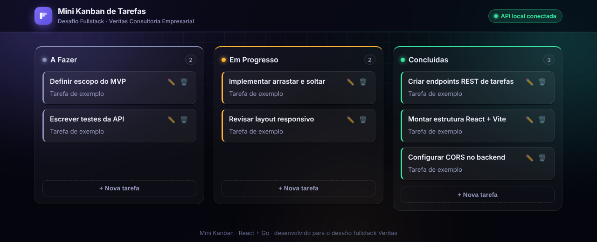
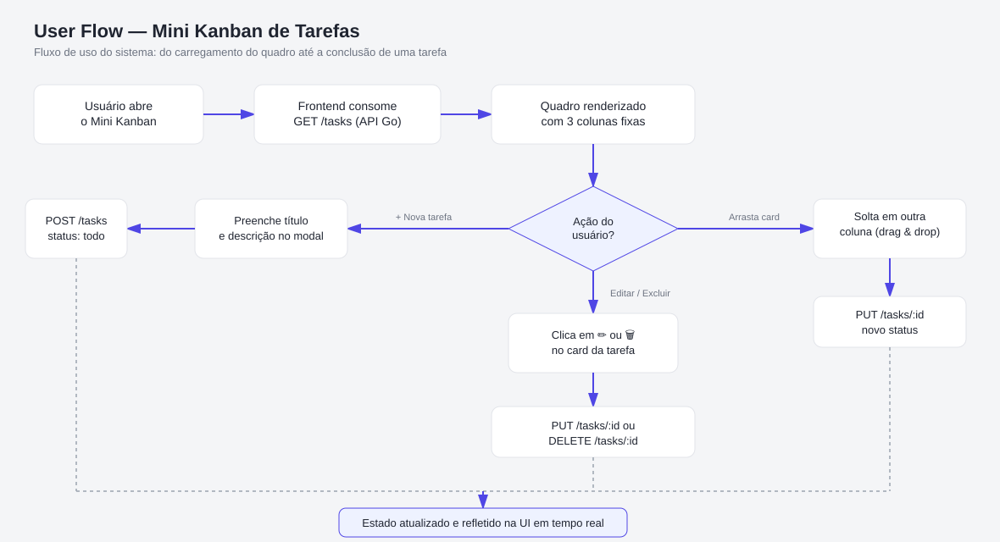

# Mini Kanban de Tarefas — Desafio Fullstack Veritas

Quadro Kanban full stack (React + Go) desenvolvido para a etapa de Desafio Prático do processo seletivo de estágio Full Stack da **Veritas Consultoria Empresarial**.

O objetivo era entregar, em prazo curto, uma aplicação completa: interface, API REST, validação e persistência.



<details>
<summary>Fluxo do usuário</summary>



</details>

## Funcionalidades

- Três colunas: **A Fazer**, **Em Progresso** e **Concluídas**.
- Criar, editar e excluir tarefas (título e descrição).
- Mover tarefas entre colunas arrastando o cartão.
- Dados preservados ao reiniciar o servidor.

## Stack

- **Frontend:** React 18 + Vite (JavaScript)
- **Backend:** Go 1.21, só com a biblioteca padrão (`net/http`, `encoding/json`), sem frameworks
- **Persistência:** em memória, com cópia automática em `backend/tasks.json` a cada alteração

## Decisões técnicas

- **Sem frameworks no Go:** a API é pequena, então a biblioteca padrão bastou e deixou o código fácil de ler.
- **`TaskInput` separado de `Task`:** o cliente envia só título, descrição e status. As datas `createdAt` e `updatedAt` são sempre definidas pelo servidor.
- **Validação de status no backend:** só `todo`, `in_progress` e `done` são aceitos. Outros valores retornam erro.
- **Middleware de CORS:** libera o frontend em outra porta durante o desenvolvimento.

## API

| Método | Rota | Ação |
|---|---|---|
| GET | `/tasks` | Lista as tarefas |
| POST | `/tasks` | Cria uma tarefa |
| GET | `/tasks/{id}` | Busca uma tarefa |
| PUT | `/tasks/{id}` | Atualiza uma tarefa |
| DELETE | `/tasks/{id}` | Exclui uma tarefa |
| GET | `/health` | Verifica se a API está no ar |

## Estrutura do repositório

```
backend/    # API em Go (main, handlers, middleware, models, store)
frontend/   # aplicação React (Navbar, Column, TaskCard, TaskModal)
docs/       # diagrama do fluxo do usuário
```

## Como rodar

Pré-requisitos: Go 1.21+ e Node.js 18+.

```bash
# 1. Backend (porta 8080)
cd backend
go run .

# 2. Frontend, em outro terminal
cd frontend
cp .env.example .env    # VITE_API_URL=http://localhost:8080
npm install
npm run dev
```

## Melhorias futuras

- Testes automatizados na API e nos componentes.
- Banco de dados no lugar do arquivo JSON.
- Deploy público da aplicação.

## Autor

Gustavo Vinicius — [LinkedIn](https://www.linkedin.com/in/gustavo-vinicius-961594219/)
